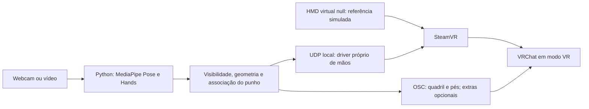

# MediaPipe no VRChat pelo SteamVR — Windows sem headset físico

Esta feature fornece código de integração, não um teste de jogo já aprovado.
O alvo é Windows, SteamVR com HMD virtual de desenvolvimento, corpo por OSC
Trackers e mãos por Skeletal Input. Não exige editar avatar no Unity; exige
avatar humanoide com rig de mãos compatível e bindings no SteamVR.

## Por que o original precisava disso

O README original manda instalar o driver, colocar o headset, calibrar no
SteamVR e só depois abrir VRChat. A versão OSC mencionava Quest standalone
em **VR**, não desktop comum. O bridge original criava trackers rígidos;
criação de HMD estava comentada e não havia transporte de ossos dos dedos.

O novo caminho é:



HMD virtual não é medição real da cabeça. Selfie Expression é outra solução
nativa do cliente e deve ficar desligado durante o uso da mesma webcam.

## 1. Código e driver compilado

Na raiz do clone:

```bat
git fetch origin
git switch feature/mediapipe-steamvr-hands
cd tracking
..\.venv312\Scripts\python.exe tools\check_steamvr.py
```

O computador do usuário já confirmou SteamVR em
`C:\Program Files (x86)\Steam\steamapps\common\SteamVR`, executáveis e
`driver_null.dll` presentes. `external_drivers: null` é aceito pela correção
`bd123f3`. Presença de arquivos ainda não prova que o HMD está ativo.

No GitHub, abra **Actions → Driver SteamVR de mãos**, selecione execução
aprovada do **mesmo branch/commit** e baixe o artefato
**steamvr-hands-Windows**. Não use a DLL antiga do projeto ju1ce para dedos.
Extraia o pacote para uma pasta permanente gravável pelo seu usuário, por
exemplo `%LOCALAPPDATA%\FIAP-MediaPipe\mediapipe_hands`.

A pasta escolhida deve conter diretamente:

```text
driver.vrdrivermanifest
bin\win64\driver_mediapipe_hands.dll
resources\input\mediapipe_hand_profile.json
```

Não precisa de Visual Studio para usar esse artefato. Para compilar os fontes,
consulte [o build C++](../../../steamvr/README.md). Os artefatos expiram em sete
dias; uma nova execução da CI gera outro pacote. Use o pacote da revisão
atual, pois a consulta de pose do HMD foi adicionada junto desta integração.

## 2. Preparar e aplicar HMD virtual e addon

Feche VRChat e SteamVR. Isso evita que sobrescrevam o arquivo de configuração
durante a instalação. A Steam pode continuar aberta. Em `tracking/`, faça a
prévia, que não grava nada:

```bat
..\.venv312\Scripts\python.exe tools\steamvr_setup.py --driver "%LOCALAPPDATA%\FIAP-MediaPipe\mediapipe_hands"
```

Confira caminhos e plano JSON. Para aplicar:

```bat
..\.venv312\Scripts\python.exe tools\steamvr_setup.py --driver "%LOCALAPPDATA%\FIAP-MediaPipe\mediapipe_hands" --apply
```

A ferramenta usa `vrpathreg.exe adddriver` para registrar **somente nosso
addon**, habilita o driver null oficial e múltiplos drivers. Preserva seções
alheias, grava atomicamente e cria um backup/journal com nome único antes de
alterar. Guarda os bytes originais, inclusive BOM/CRLF. Não modifica arquivos
do VRChat nem instala addons de terceiros. Se o arquivo mudou desde o plano,
interrompe; se a gravação falha após registro, tenta remover o novo registro.

Guarde o caminho `backup` impresso. Para desfazer, com SteamVR/VRChat fechados:

```bat
..\.venv312\Scripts\python.exe tools\steamvr_setup.py --restore "CAMINHO_DO_BACKUP.json"
```

Restauração exata quando nada mudou; se SteamVR acrescentou metadados, desfaz
só nossos campos e preserva as outras alterações. Se alguém mudou um campo
que também alteramos, recusa sobrescrever e informa o campo em conflito.
Não remove addon que já estava registrado antes da execução.

## 3. Vincular as ações reais do VRChat

O plano tenta encontrar `actions_manifest` em StreamingAssets da instalação
do VRChat, incluindo bibliotecas Steam adicionais. Se retornar um caminho,
gere primeiro a prévia:

```bat
..\.venv312\Scripts\python.exe tools\steamvr_bindings.py --actions "CAMINHO_DO_ACTIONS.json"
```

Com SteamVR e VRChat fechados, grave apenas no pacote do nosso driver:

```bat
..\.venv312\Scripts\python.exe tools\steamvr_bindings.py --actions "CAMINHO_DO_ACTIONS.json" --driver "%LOCALAPPDATA%\FIAP-MediaPipe\mediapipe_hands" --write
```

O gerador usa nomes que existem no manifest, não cria endpoints nem edita
arquivos do jogo. Preserva bindings de outros apps e faz backups do perfil.
`manual_interact_binding_needed: true` significa que gatilhos ainda precisam
de mapeamento manual. `actions_manifest: null` não significa que tudo está
configurado: use o Binding UI ou forneça o manifest correto.

Alternativa manual: no SteamVR, **Settings → Controllers → Show Binding UI**,
selecione **VRChat** e o dispositivo **MediaPipe optical hand** /
`fiap_mediapipe_hand`. Crie/salve binding próprio:

| Entrada | Ação VRChat |
|---|---|
| Pose raw da mão esquerda/direita | Pose correspondente (ou Pose compartilhada, conforme o manifest) |
| Skeleton left | SkeletonLeftHand |
| Skeleton right | SkeletonRightHand |
| Trigger click esquerdo/direito | Use/Interact correspondente, para confirmação explícita |

Não selecione emulação Knuckles/Touch nem outro tipo de controlador. Não
atribua cliques automáticos a curls. Reinicie SteamVR após alterar os arquivos
de perfil para que sejam carregados. Sem Pose/Skeleton vinculados, o driver
pode receber dados sem que os dedos do avatar se movam.

## 4. Conferir runtime e iniciar captura

Abra SteamVR. Confira se o addon `mediapipe_hands` está habilitado em
**Startup/Shutdown → Manage Add-ons**. Use **Display VR View** para visualizar
o ambiente virtual no monitor, se necessário. Em outro terminal `tracking/`:

```bat
..\.venv312\Scripts\python.exe tools\steamvr_hands_check.py --head
```

É necessário obter `hmd_valid: true`. A consulta mostra a matriz bruta do HMD
para diagnóstico; não é a pose corporal da câmera. `tracked_mask: 0` antes da
captura é esperado. Timeout significa que o addon não respondeu; não prossiga
como se o runtime estivesse aprovado.

### Preparação de cômodo C201 e matriz bruta com Y zero

No Windows do usuário, o driver respondeu com HMD válido e matriz bruta
identidade, mas SteamVR mostrou **Preparação de cômodo (C201)**. Conclua a
preparação pelo link do próprio aviso, escolhendo **Standing Only / Somente
em pé**. Ao definir a distância virtual do HMD ao piso, use uma referência
explícita para o teste, por exemplo **1,70 m / 170 cm**, observando a unidade
do campo. Não há headset físico sendo colocado no chão ou medido neste modo.
Se o assistente bloquear uma etapa, registre a tela/erro em vez de presumir
que a configuração terminou.

O SDK declara que GetRawTrackedDevicePoses devolve poses no espaço bruto de
cada driver. Portanto, Y bruto igual a zero, sozinho, não prova altura zero
no espaço calibrado da aplicação; pode continuar zero depois do assistente.
A autoescala atual usa essa coordenada bruta e recusa Y não positivo. Para
este teste, **desmarque Calibrar escala automaticamente e use Escala 1,00**
como ponto de partida, ajustando-a manualmente quando houver dados do avatar.
Não substitua silenciosamente a matriz recebida por uma altura inventada.

`enableHomeApp=false` desativa o SteamVR Home. A visão VR pode permanecer
preta antes de abrir um aplicativo VR; isso não substitui o teste no cliente.
Após o assistente, feche outras execuções que usam a webcam e inicie o
aplicativo abaixo. Quando mostrar mãos/punhos e ombros visíveis, consulte
novamente o driver: máscara 1 = esquerda, 2 = direita, 3 = ambas recebidas.
Isso ainda não comprova que os bindings foram aplicados pelo VRChat.

Inicie:

```bat
..\.venv312\Scripts\python.exe run.py
```

Selecione **SteamVR mãos + OSC**, câmera correta, IP `127.0.0.1`, porta `9000`.
Hands é ativado automaticamente; não use trackers rígidos experimentais de
punhos. Comece com quadril e pés, deixando os cinco trackers adicionais
desligados. Mantenha imagem em pé e corpo inteiro enquadrado; para calibrar
corpo, quadril/pés precisam estar visíveis. Mãos exigem resolução suficiente.

**Recalibrar os ajustes automáticos** usa a pose do HMD consultada no driver
para yaw/escala e mantém a lógica de inclinação original. É uma calibração do
remetente. Altura bruta do HMD zero/negativa não gera escala zero: o ajuste é
recusado com orientação para corrigir origem/altura ou usar escala manual.
O referencial de desenvolvimento é estacionário; não simula uma cabeça
fisicamente rastreada nem garante alinhamento universal entre drivers.

## 5. VRChat em modo VR e calibração do receptor

Na Steam, inicie **VRChat em modo SteamVR/VR**, não “Desktop Mode”. Habilite
OSC no cliente e confirme recepção corporal. O bloco Calibrate FBT é
documentado para **VR Only**, com pelo menos um tracker ativo.

### Abrir o menu sem botão de controle físico

Com OSC habilitado no VRChat, execute em `tracking/` e volte à janela do jogo
durante os três segundos de espera:

```bat
..\.venv312\Scripts\python.exe tools\vrchat_desktop_check.py --command menu-left --delay 3 --send
```

O comando oficial `/input/QuickMenuToggleLeft` **alterna** o menu: se já
estiver aberto, pode fechá-lo. Para o lado direito, use `--command menu-right`.
Sem `--send`, mostra somente a prévia. A espera aceita de 0 a 30 segundos.
O pulso envia inteiros 0, 1, 0, liberando o botão mesmo após interrupção.
Sem `--command`, o teste anterior de pulo permanece como padrão.

Fonte: [OSC as Input Controller](https://docs.vrchat.com/docs/osc-as-input-controller).
UDP não confirma recepção nem o estado do menu. Esse comando não seleciona
opções, não movimenta o cursor e não inicia Calibrate FBT automaticamente;
a interação pelo apontador das mãos e o binding Use/Interact continuam
dependendo da validação real no cliente. Registre se o menu apareceu e se
é possível apontar/selecionar antes de considerar a navegação aprovada.

Se o menu abre, mas não há botão físico para acionar a mão, teste a ação
oficial `/input/UseRight` em modo VR. Primeiro aponte a mão direita para
uma opção inofensiva, como Configurações. Em outro terminal, execute:

```bat
..\.venv312\Scripts\python.exe tools\vrchat_desktop_check.py --command use-right --delay 5 --send
```

Volte ao jogo e mantenha o apontador sobre a opção durante a espera. Para a
mão esquerda use `--command use-left`. O comando envia somente um pulso
0 → 1 → 0 e independe do binding de gatilho do driver; não move o apontador.
UseLeft/UseRight são documentados para VR. Se não aparece raio/apontador,
ou ele não acompanha a mão, um clique sozinho não resolve: verifique pose
válida, associação de mãos e bindings antes de repetir. Isso é um teste
de interação, não uma confirmação de que todo menu aceitará a ação.
Não há cliques contínuos, automáticos por gesto ou confirmação automática
de compras, diálogos ou calibração.

Inicie **Calibrate FBT**. Com corpo alinhado e mãos/punhos detectados, use
**Confirmar FBT no VRChat em 3 segundos** no nosso aplicativo e volte ao jogo.
O comando só pulsa os gatilhos; não abre por si só o modo de calibração.
Alternativa de terminal:

```bat
..\.venv312\Scripts\python.exe tools\steamvr_hands_check.py --confirm --delay 3
```

Requer bindings Use/Interact. A liberação acontece no driver após 300 ms,
mesmo sem novos quadros. Mão inválida não aciona gatilho. Se houver só uma
mão, o cliente precisa estar configurado para calibração com uma mão. O modo
deprecated Finger Tracking Exclusive pode ignorar inputs além de Pose e
Skeleton; confira essa opção se a confirmação não responder.

Confira dedos em **Accurate Hands**, conforme o guia de drivers do VRChat,
para separar esqueleto recebido de retargeting do avatar. Depois teste no
espelho do jogo. Nenhuma etapa depende dos parâmetros `MP_*` do avatar nesse
destino; o backend OSC de avatar anterior continua disponível separadamente.

## Como testar e explicar o código

- `steamvr_skeleton.py`: associa punho de Hands ao punho de Pose visível e
  próximo na imagem. Converte sinais/rotações como o corpo. Constrói eixos por
  vetores e produtos vetoriais; transforma cada osso para o espaço do pai.
- 21 keypoints não viram 31 observações novas. Quatro metacarpos intermediários
  são interpolados entre punho/MCP; root/punho e ossos auxiliares atendem à
  hierarquia da API. Abertura e flexão vêm dos segmentos observados, não de uma
  animação genérica acionada pelos cinco curls.
- `steamvr_hands_backend.py`: corpo usa o OSC já existente; mãos usam UDP local.
  Sem Pose suficiente para posicionar um punho, envia invalidação em vez de
  uma posição padrão. Pausa/perda/reinício limpam estado.
- `steamvr/src`: valida pacote, ordem, quaternions, limites e timeout no
  receptor; pose inválida é marcada com `poseIsValid=false`. Expira em 500 ms
  se o processo/câmera parar. Isso não garante como cada avatar anima a perda.
- `steamvr_setup.py` e `steamvr_bindings.py`: isolam a preparação Windows,
  leitura de configuração/ações e restauração, sem mudar o núcleo de PDI.

Testes Python em `tracking/`: `..\.venv312\Scripts\python.exe -m unittest
discover -s tests -v`. Testes C++ e build Windows estão na CI. O [ensaio
positivo](../../evaluation/steamvr_skeleton_integration.json) executou Hands
real sobre imagem pública, produziu 31 transforms e teve o pacote aceito pelo
decoder C++ compilado; a origem global é uma fixture somente desse ensaio.
Não mede jitter, FPS real ou movimento no jogo.

PDI aplicado: BGR→RGB, keypoints normalizados para enquadramento/associação,
coordenadas espaciais estimadas para vetores e orientação, confiança de
lateralidade e confirmação temporal. Não é profundidade medida. A câmera
única pode ocluir mãos, falhar em detalhes de dedos ou estimar poses plausíveis
incorretas. Explicite essas limitações na apresentação acadêmica.

## Situação e próximas validações

### Janela do jogo, espelho e saída do HMD virtual

São três superfícies diferentes. A resolução da janela normal do **VRChat**
não é controlada por `driver_null.renderWidth`. Na Steam → Biblioteca →
VRChat → Propriedades → Geral → Opções de inicialização, preserve opções
não relacionadas e remova valores conflitantes de resolução antes de usar:

```text
-screen-width 1920 -screen-height 1080 -screen-fullscreen 0
```

Use uma resolução suportada pelo seu monitor; por exemplo, 1280×720 se não
suportar 1920×1080. Reinicie o jogo **em modo VR**. Estes parâmetros são
[documentados pelo VRChat](https://docs.vrchat.com/docs/launch-options).
Para desfazer, remova somente esses três parâmetros. Não troque para desktop
para ocultar uma janela: isso muda o caminho de rastreamento que estamos testando.

O **VR View / espelho do SteamVR** é opcional. Feche sua própria janela ou,
com SteamVR/VRChat fechados, use a configuração reversível abaixo. O branch
`feature/windows-vr-display` preserva os valores de exibição já existentes;
versões anteriores redefiniam os seis campos de janela/render para 1280×720
e posição zero em toda execução do instalador.

```bat
..\.venv312\Scripts\python.exe tools\steamvr_setup.py --driver "C:\Users\mauro\Downloads\FIAP-MediaPipe" --hide-mirror
..\.venv312\Scripts\python.exe tools\steamvr_setup.py --driver "C:\Users\mauro\Downloads\FIAP-MediaPipe" --hide-mirror --apply
```

O primeiro comando mostra o plano; o segundo grava com backup. `--hide-mirror`
define `steamvr.showMirrorView=false`, chave presente no SDK OpenVR. Não
fecha a janela de renderização do compositor/HMD virtual. Se uma janela
semelhante continuar aparecendo, registre seu título e o executável dono
antes de fechá-la: encerrar o compositor pode interromper o runtime. Não
ative Direct Display Mode para tentar ocultar a saída do driver null.

O usuário confirmou título **Headset Window** e imagem estéreo com os dois
olhos. Isso é compatível com a saída de exibição do HMD virtual; não é a
janela normal do VRChat e não deve ser prometida como removida por
`--hide-mirror`. Minimize-a para deixar a janela do jogo acessível. Não há
ocultação automática implementada/validada para essa saída. Minimizar também
não comprova economia de renderização ou correção da postura do avatar.

Para mudar **separadamente** a resolução renderizada para o HMD de teste,
adicione `--render-size 1920x1080` à prévia e ao comando de aplicação. Isso
preserva tamanho/posição da janela do HMD e resolução da janela do jogo.
O custo de GPU/memória pode aumentar; não é um aumento medido de qualidade
de rastreamento. Cada dimensão aceita 320 a 4096 pixels. Sem a opção,
preserva os campos existentes e só preenche campos ausentes com 1280×720.
Use `--restore` com o novo backup para desfazer as mudanças de SteamVR.

Teste no Windows: confirme janela normal na resolução escolhida, ausência
do espelho opcional e continuidade da captura/rastreamento. Esta correção
de exibição não resolve nem comprova a altura/orientação do avatar.

O usuário confirmou arquivos SteamVR/null no Windows. Driver, teste do
protocolo e testes automatizados não aprovam sozinhos o VRChat. Ainda precisam
ser registrados: HMD virtual ativo, bindings reais, Calibrate FBT em VR,
movimento corporal, cada dedo, perda/retorno, enquadramento parcial e latência.
Não há merge aprovado enquanto essa validação estiver pendente.

Atualização do teste manual: HMD e driver responderam no Windows com
`hmd_valid=true`, `tracked_mask=0` e matriz bruta identidade antes da captura.
A captura mostrou C201, preparação de cômodo ainda pendente. Não houve
confirmação de corpo/dedos em movimento no jogo.
